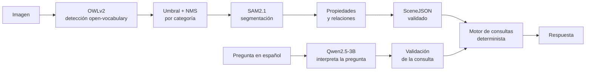

# Comprensión Visual de Escenas

**Pipeline de visión por computadora y LLMs que convierte una imagen en una representación estructurada de la escena y responde preguntas en lenguaje natural sobre ella.**

Trabajo práctico de la cátedra de **Inteligencia Artificial** — Ingeniería en Sistemas de Información, UTN Facultad Regional Córdoba (2026). Presentado en una competencia privada de Kaggle.

---

## ¿Qué hace?

Dada una fotografía, el sistema:

1. **Detecta** los objetos presentes entre 120 categorías, a partir de sus nombres en texto.
2. **Segmenta** la silueta exacta de cada objeto.
3. **Describe** cada objeto: posición (grilla 3×3), tamaño, color dominante y relaciones espaciales con los demás (`left_of`, `above`, `overlaps`…).
4. Genera un **SceneJSON** validado contra un schema oficial.
5. **Responde preguntas** en español sobre la escena ("¿Cuántas sillas hay?", "¿El espejo está arriba del lavamanos?"), usando solo la información del SceneJSON.

## Pipeline



| Etapa | Modelo / técnica |
|---|---|
| Detección | [OWLv2](https://huggingface.co/google/owlv2-base-patch16-ensemble) (`owlv2-base-patch16-ensemble`), sin reentrenar, con la plantilla `"a photo of a {categoría}"` |
| Postproceso | Umbral de confianza 0,20 + NMS por categoría (IoU 0,5) |
| Segmentación | [SAM2.1](https://huggingface.co/facebook/sam2.1-hiera-large) (`sam2.1-hiera-large`), usando cada caja como *prompt* |
| Preguntas | [Qwen2.5-3B-Instruct](https://huggingface.co/Qwen/Qwen2.5-3B-Instruct): traduce la pregunta a una consulta estructurada; **el código calcula la respuesta** |

**Principio de diseño:** el LLM solo traduce y redacta; nunca calcula ni inventa. Cada consulta se valida (operación soportada y clases del vocabulario) antes de ejecutarse, y si la pregunta no se puede responder con la información disponible, la respuesta es `unsupported`.

## Resultados

Métricas sobre las 120 imágenes de desarrollo (1.790 objetos anotados) y las 40 preguntas cerradas del benchmark:

| Etapa | Métrica | Valor |
|---|---|---|
| Detección (cajas) | F1 / precisión / recall | **0,646** / 0,732 / 0,578 |
| Segmentación (máscaras) | F1 / precisión / recall | **0,617** / 0,701 / 0,551 |
| Segmentación | Cajas correctas con máscara correcta | 91,9 % |
| SceneJSON | Escenas válidas (schema + consistencia) | 120 / 120 |
| Preguntas, modo determinista | Exactitud / fidelidad | 0,75 / 1,00 |
| Preguntas, modo LLM | Interpretación / exactitud / fidelidad | 0,75 / 0,57 / 1,00 |
| Pipeline completa | Tiempo por imagen / imágenes con error | 1,63 s / 0 |

## Hallazgos principales

- **Los objetos son muy pequeños.** La mediana ocupa el 0,29 % de la imagen y el 54 % es "chico" según COCO. Esto explica buena parte de los objetos perdidos.
- **El cuello de botella es el detector, no la segmentación.** SAM2 segmenta bien el 92 % de las cajas correctas. El análisis de propagación de errores muestra que la mayoría de los objetos se pierden por **confianza baja** (401 de 1.790) o porque **el detector nunca los ve** (179, casi todos pequeños).
- **Calibración, no ceguera.** El detector encontraba 28 de las 29 personas, pero con confianzas de 0,01 a 0,20. Las confianzas de OWLv2 no son comparables entre categorías, y un umbral único perjudica a algunas.
- **Errores seguros vs. silenciosos.** Cuando el LLM falla, casi siempre es al elegir la clase. Se priorizó que esos errores terminen en `unsupported` en lugar de en una respuesta incorrecta sin aviso.

## Experimentos

Cada experimento cambia una sola variable y tiene una regla de decisión fijada **antes** de ejecutarlo (por ejemplo, adoptar el cambio solo si el F1 mejora al menos 0,02).

| Experimento | Resultado | Decisión |
|---|---|---|
| OWLv2 **large** en lugar de base | F1 0,646 → 0,616: más recall en objetos chicos, menos precisión; 4,4× más lento | No se adopta |
| Umbral del NMS 0,3 / 0,7 | F1 0,646 / 0,637 | No se adopta (confirma 0,5) |
| Combinación de detectores base + large | F1 0,641 | No se adopta |
| 4 plantillas de texto en el detector | F1 +0,003; 3,7× más lento | No se adopta |
| Elección de clase por similitud de embeddings | Interpretación 0,75 → 0,65 | No se adopta |
| Híbrido: lista + similitud de respaldo | +1 pregunta correcta, pero errores silenciosos 4 → 6 | No se adopta |
| **Control de los textos del LLM** contra el SceneJSON | Fidelidad de las respuestas 0,60 → **1,00** | **Se adopta** |

La detección base resultó un óptimo estable. La mejora adoptada actúa sobre la confiabilidad de los textos generados por el LLM.

## Ingeniería y reproducibilidad

- **Evaluador local** que reproduce la política de evaluación de **LVIS** (categorías verificadas, ausentes y no exhaustivas), validado con **17 pruebas automáticas** de resultado conocido.
- **Análisis exploratorio** en el que cada pregunta termina en una decisión de diseño (umbral del NMS, definición de tamaño y posición, límite de detecciones).
- **Trazabilidad por etapa:** cada imagen deja en `trazas.jsonl` los parámetros, la cantidad de objetos de entrada y salida, el tiempo y el estado de cada etapa. Si una etapa falla, la ejecución continúa con la imagen siguiente.
- **Validación doble del SceneJSON:** contra el schema y con chequeos de consistencia interna (ids únicos, relaciones válidas, máscaras del tamaño de la imagen, coherencia de `area_ratio`).
- **Sin fuga de información:** las anotaciones se usan solo para el análisis exploratorio y la evaluación, nunca para la inferencia.

## Stack

Python · PyTorch · Hugging Face Transformers · torchvision · pycocotools · pandas · NumPy · Matplotlib · jsonschema · Kaggle (GPU)

## Estructura del repositorio

```
├── comprension_visual_escenas.ipynb   # Notebook completo con salidas
├── escenas-deteccion.png              # Ejemplo de detección
└── README.md
```

> **Nota sobre los datos:** las imágenes, anotaciones y archivos de la competencia no se incluyen, porque pertenecen a una competencia privada de la cátedra. El notebook se publica con todas sus salidas para que se puedan ver el proceso y los resultados sin ejecutarlo.

## Autor

**Juan Pedro Roldán** — Estudiante de Ingeniería en Sistemas de Información (UTN FRC)

[Portfolio](https://juanpedroroldan.com.ar) · [LinkedIn](https://www.linkedin.com/in/juan-pedro-roldan/) · [GitHub](https://github.com/juanro03)
